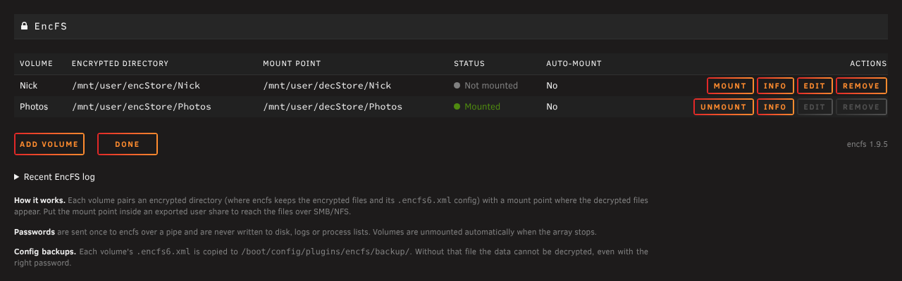

# EncFS for Unraid

Mount [EncFS](https://github.com/vgough/encfs)-encrypted directories on Unraid 7 from the webGUI or the command line.



- **Self-contained.** Ships a statically linked encfs 1.9.5 (libfuse 2, OpenSSL and tinyxml2 built in), so nothing else has to be installed and Unraid OS updates do not break it.
- **Multiple volumes**, each an encrypted directory plus a mount point, managed under *Settings > User Utilities > EncFS*.
- **Careful password handling.** The password goes from the dialog straight to encfs's stdin. It never appears on a command line, in the environment, in a file or in a log, and a wrong password is reported in the dialog.
- **Clean array stop.** Every EncFS mount under `/mnt` is unmounted when the array stops. A busy mount is retried, lazily unmounted and its FUSE connection aborted, so the stop never hangs on "Retry unmounting user shares".
- **Stale mount detection.** If encfs dies ("Transport endpoint is not connected"), the page says so and offers a forced cleanup.
- **Optional auto-mount** at array start from a password file.
- **Config backups.** Each volume's `.encfs6.xml` is copied to `/boot/config/plugins/encfs/backup/`. Without that file the data cannot be decrypted, even with the password.
- **Mount point lock.** While a volume is not mounted, its empty mount point is set to mode 000. SMB/NFS users then cannot write plaintext files into a share that normally holds decrypted data.
- **New volumes.** Create them from the webGUI with encfs's *standard* or *paranoia* presets.
- **`encfs-mgr` command line tool** for scripting and SSH use.

## Install

*Plugins > Install Plugin*, paste:

```
https://raw.githubusercontent.com/nick5429/unraid-encfs/master/encfs.plg
```

Requires Unraid 7.0 or newer.

## Using it

1. **Add volume.** Give it a name, the encrypted directory and a mount point.
   - Encrypted directory example: `/mnt/user/encStore/myvolume`
   - Mount point example: `/mnt/user/decStore/myvolume`
2. **Mount.** Enter the password. The decrypted files appear at the mount point. If the mount point is inside an exported share, they are reachable over SMB/NFS like any other folder.
3. **Unmount** when done, or leave it mounted. It is unmounted automatically when the array stops.

If the encrypted directory is empty or does not exist yet, the volume shows **Initialize**, which creates a new encfs volume there.

Decrypted files are presented as owned by `99:100` (nobody:users) by default, matching Unraid shares. Both values can be changed under *Advanced*.

### Auto-mount

Set *Auto-mount when the array starts* to *Yes* and point it at a file whose first line is the password. Anyone who can read that file can decrypt the volume, so be deliberate about where it lives:

- **Not recommended:** `/boot` (readable through the flash share) and the array.
- **Common pattern:** fetch the file into `/root` at boot, e.g. from the `go` file, and `chmod 600` it.

Volumes are auto-mounted on the `disks_mounted` event, before Docker and VMs start, so containers that bind-mount the decrypted path see it.

### Command line

```
encfs-mgr list
encfs-mgr mount NAME                    # prompts for the password, echo off
encfs-mgr mount NAME --stdin            # password on stdin (one line)
encfs-mgr mount NAME --password-file F
encfs-mgr unmount NAME [--force]
encfs-mgr unmount-all [--force]
encfs-mgr info NAME                     # encfsctl info, no password needed
encfs-mgr backup NAME | backup-all
```

To change a volume's password, unmount it and run:

```
encfsctl passwd /mnt/user/encStore/myvolume
```

The flash backup is refreshed on the next mount or array start. The old backup is kept with a timestamp.

### Upgrading from the 2016 plugin

The old plugin kept one volume in `/boot/config/plugins/encfs/encfs.cfg` (`ENCDIR0`/`DECDIR0`). On install, that volume is imported once and the old file is renamed to `encfs.cfg.legacy`. The old boost/rlog/tcl/expect packages are not needed. If any of them sit in `/boot/extra`, the installer points them out.

Existing volumes created with the old instructions mount unchanged. The plugin uses the same `encfs --public ... -- -o uid=99 -o gid=100` invocation.

## How it works

| Piece | Location |
| --- | --- |
| encfs, encfsctl | `/usr/local/bin` (package `encfs-static`) |
| Settings page | `/usr/local/emhttp/plugins/encfs/EncFS.page` |
| Core logic (PHP, shared by page, CLI and events) | `/usr/local/emhttp/plugins/encfs/include/Encfs.php` |
| JSON endpoint for the page | `/usr/local/emhttp/plugins/encfs/include/exec.php` |
| Array start: config backup + auto-mount | `event/disks_mounted` |
| Array stop: unmount everything under `/mnt` | `event/unmounting_disks` |
| CLI | `/usr/local/sbin/encfs-mgr` |
| Volume settings | `/boot/config/plugins/encfs/volumes.cfg` |
| Config backups | `/boot/config/plugins/encfs/backup/` |

Two details the 2016 plugin got wrong and that are handled here:

- **No `expect`/`at` workarounds.** encfs is started with `--stdinpass`, and the password is written to a pipe.
  - encfs is launched through `scripts/exec-detached`, which closes every inherited file descriptor first. Without it, the daemonized encfs keeps the web server's sockets open, which is the likely cause of the hanging page and the `at` workaround in the old plugin.
  - The mount command now runs synchronously, so failures are reported.
- **Refusing to create volumes by accident.** encfs silently creates a new volume when it cannot find a config. The plugin never starts encfs for a mount unless the volume's config file exists.

Everything is logged to the syslog under `encfs-plugin` and `encfs-<volume>`. The page has a *Recent EncFS log* panel.

## Security notes

- **EncFS is old software with known weaknesses.** A [2014 audit](https://defuse.ca/audits/encfs.htm) found that an attacker who can see several versions of the encrypted files (for example, in cloud sync history) can learn things about the plaintext. It remains reasonable for protecting data at rest on a server you control. For new data, consider whether a maintained alternative fits your needs better.
- **The password crosses the network when you mount from the webGUI.** The mount dialog warns when the page is not on HTTPS. HTTPS can be enabled under *Settings > Management Access*.
- **The `.encfs6.xml` config holds the volume key, wrapped by your password.** It already sits unencrypted next to the data, so the flash backup does not weaken anything. Keep another copy off the server as well.

## Building

The packages that `encfs.plg` installs live in `packages/` and are served from `raw.githubusercontent.com`:

- `encfs-static-1.9.5-x86_64-1.txz` - the static encfs build. Only rebuilt when encfs itself changes.
- `encfs-plugin-<version>-noarch-1.txz` - the plugin files. Rebuilt for every plugin version.

```
build/build-encfs-static.sh          # on Ubuntu 24.04 x86_64; writes packages/encfs-static-*.txz
build/build-plugin.sh 2026.10.20     # writes packages/encfs-plugin-*.txz, regenerates encfs.plg
git add -A packages encfs.plg && git commit -m "Release 2026.10.20" && git push
```

`encfs.plg` embeds the SHA256 of both packages, so commit exactly the files `build-plugin.sh` hashed. The plugin package build is reproducible, so rebuilding from unchanged sources gives the same hash.

A GitHub Actions workflow (lint, package build, FUSE integration tests) is in `ci/github-actions-ci.yml`. Copy it to `.github/workflows/ci.yml` to enable it.

## Tests

- `tests/integration.sh` (root and `/dev/fuse` required) exercises real mounts through the CLI and core library: wrong password, busy/forced unmount, stale mounts, read-only, paths with spaces, password-file auto-mount, array-stop unmount and legacy migration.
- `tests/harness/router.php` serves the page with PHP's built-in server and the real Unraid stylesheets.
- `tests/ui_test.py` drives it with Playwright.
- `tests/check-plg-scripts.php` extracts the PLG's inline scripts for shellcheck.

## License

encfs is LGPL/GPL. License texts for encfs and the statically linked libraries (libfuse, OpenSSL, tinyxml2, easylogging++) are installed in `/usr/doc/encfs-static-1.9.5/`, and `build/build-encfs-static.sh` rebuilds the binaries from pinned upstream sources.
